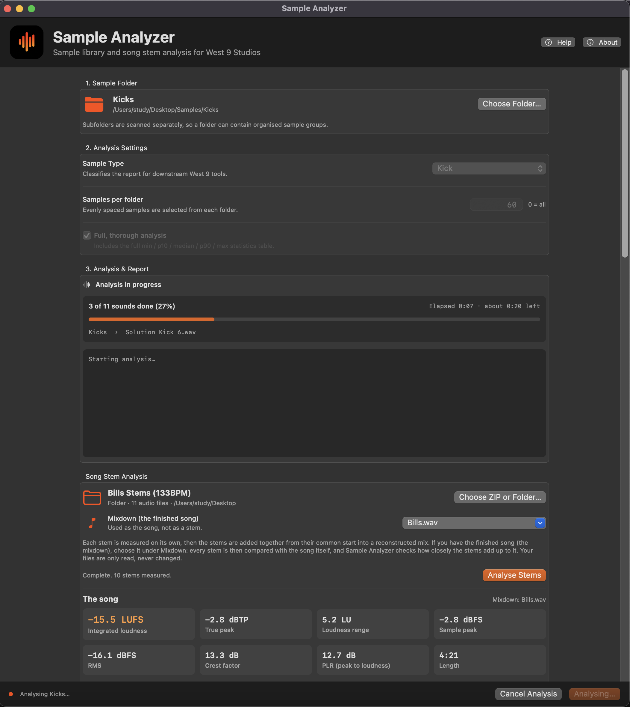
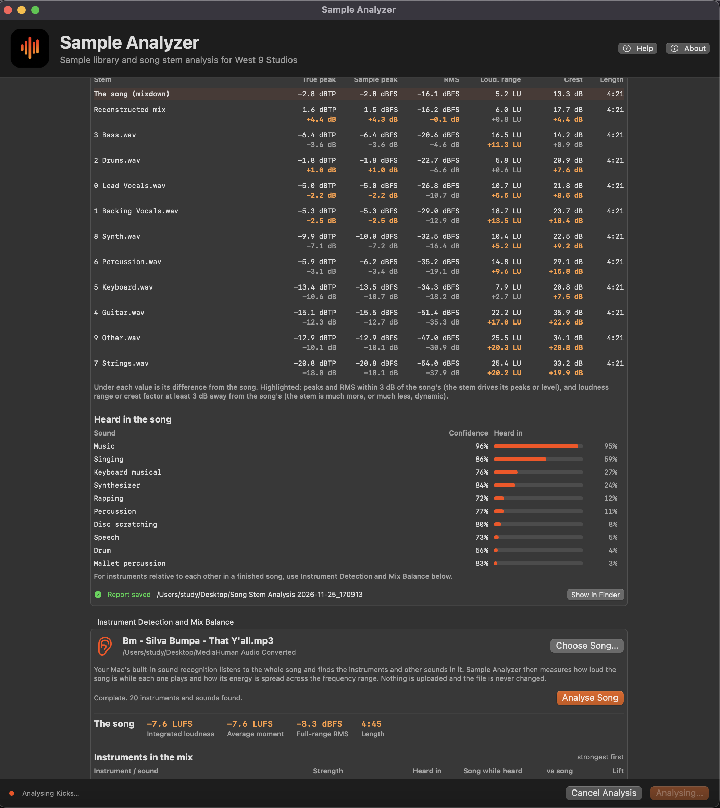
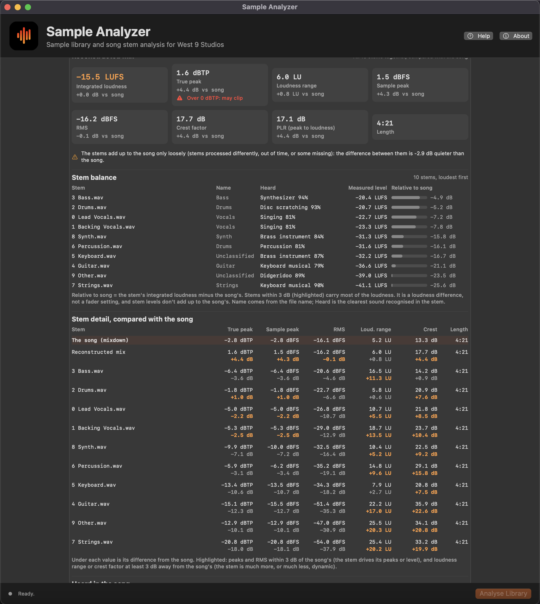
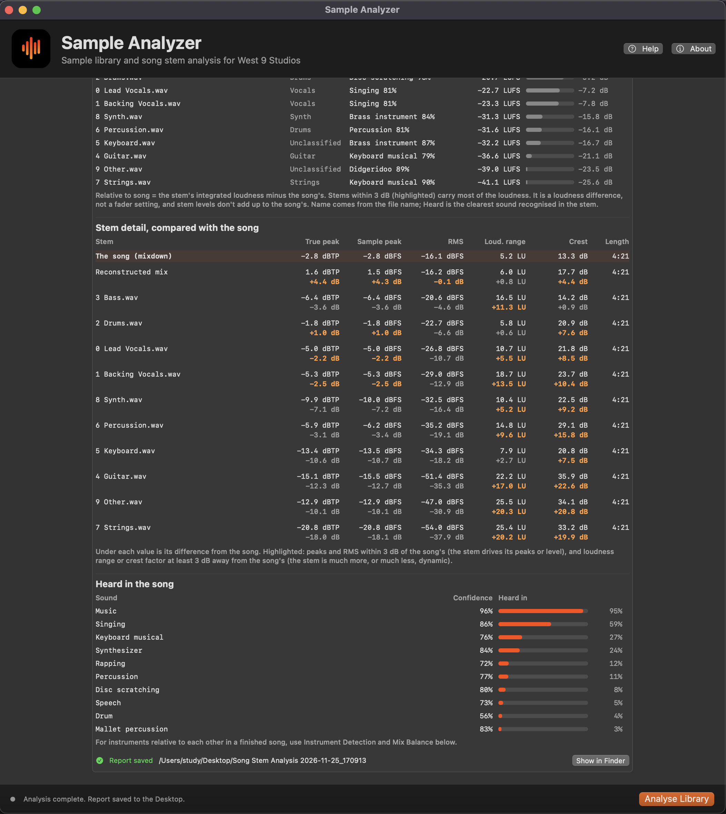

# Sample Analyzer

**Sample Library and Mix Analysis.** Sample Analyzer is a free macOS app that measures a folder of drum samples and saves a clear report, measures the balance of a song's stems against the finished song, and shows how the instruments sit in a finished mix — all on your Mac.

[**Download Sample Analyzer 1.1**](https://github.com/west9studios/Sample-Analyzer-Releases/releases/latest) · macOS 13 or later · 3.0 MB · Free, no account or licence key

## What it does

- **Sample library analysis:** choose a folder of kicks, snares, hats or other sounds and measure them: peak, RMS, loudness, crest factor, length, pitch, stereo and frequency balance. Every folder inside is measured as its own group.
- **Built around known-good sounds:** measure sounds you already trust, then use the results as a reference for your own music. Samples give you instrument profiles; finished songs and stems show how the instruments sit against each other and the song.
- **Reference profiles and matching:** every run saves a profile of its sounds (the usual range of each measurement, per sample type). Choose one as the reference, measure another folder such as your own library, and every sound is marked as a match or as different, with the reason. Select sounds and right-click to reveal them in Finder: keep the matches, and decide for yourself about the rest. Nothing is ever deleted or moved for you.
- **Scan overview:** the headline figures for the whole run at the top of the results and the report — samples measured, time taken, stereo and pitched files, and the median peak, RMS, crest factor and effective duration.
- **Reports:** a short summary, a full spreadsheet and a reference profile for every run, saved to a new folder in one central `Sample Analyzer Reports` folder on your Desktop.
- **Library insights:** sounds grouped by their low end, and a list of the ones that start abruptly so you know which to listen to.
- **Song Stem Analysis:** choose a ZIP or a folder of stems (for example from Suno). See every stem's loudness, true peak, loudness range, peaks, RMS and crest factor, and how each compares with the finished song.
- **Mixdown aware:** choose the finished song separately, or let Sample Analyzer find it. The stems are lined up with the song in time, and you're told how closely they add up to it.
- **A plain-English summary:** what mastering did to the song, whether the stems would clip added together, where the song sits against streaming levels, and which parts lead the mix.
- **Instrument Detection and Mix Balance:** listen to a finished song on your Mac, find its instruments, and see how they sit in the mix — how strongly each stands out, how much of the song it plays in, how much louder the song gets when it plays, and the song's balance across seven frequency ranges.
- **Progress you can see:** every long job shows a progress bar with the time so far and roughly how long is left, and can be stopped.
- **Read-only:** your samples, stems and songs are never changed.
- **Your colours:** Dark by default, like the other West 9 Studios apps, with Light and Match the Mac options and a Colours window.
- **Native on every Mac:** runs on Apple silicon and Intel Macs.

## See it in action

<table>
  <tr>
    <td width="50%"></td>
    <td width="50%"></td>
  </tr>
  <tr>
    <td align="center">Measure a sample library, with progress you can see</td>
    <td align="center">Stem detail and the sounds heard in the song</td>
  </tr>
  <tr>
    <td width="50%"></td>
    <td width="50%"></td>
  </tr>
  <tr>
    <td align="center">The stems added together, compared with the finished song</td>
    <td align="center">A Help Center for every function</td>
  </tr>
</table>

## What's new

- Better analysis: the measurements in your scans and in Song Stem Analysis are more accurate and more dependable, so the figures you see are ones you can trust.
- Reference profiles and matching: every run saves a profile of its sounds. Choose one under Analysis Settings to see which sounds in another folder match your known-good sounds and which differ, then show them in Finder (right-click ▸ Reveal in Finder).
- Play and stop buttons in the Different and Similar lists, plus an Autoplay option in Settings so you can step through the list with ↑ ↓. Choosing another sound stops the first.
- Reports are named after what you analysed: library reports carry the folder name and the run's date and time on every file (so a reference profile is never just "profile"), and Song Stem Analysis and Instrument Detection reports carry the ZIP, folder or song name and a timestamp.
- Stricter matching, and you choose how strict: Loose, Normal or Strict under Compare with a reference profile. A sound that is a long way off in even one measurement (for example much longer than the reference) now differs instead of matching.
- The Different and Similar lists are in order of closest match to the reference, with an Order menu to flip them.
- One reports folder: every report, from the library analysis, Song Stem Analysis and Instrument Detection, is saved in a single Sample Analyzer Reports folder on your Desktop instead of being scattered across it. Choose another folder, or show it in Finder, under Settings ▸ Reports.
- Clear button: wipe the results and the folder choice to start fresh on the next folder, keeping your reference profile and settings. Choosing another folder now also clears the old Library Insights, which used to stay on screen.
- Each Choose button remembers where you last chose from, separately: picking a report no longer moves the sample folder button, and the song, stems, mixdown, reference profile and reports folder buttons each open where you last used them.
- The Reason filter now works in the Similar list too: see the matches that are slightly Brighter or Longer, or only the ones that are in range on everything.
- Why a sound differs: every sound has a % match, and selecting one shows a score for each measurement (its value, the reference's usual range and a score out of 100). The same figures are saved in a match details spreadsheet.
- Match lists: filter the Different list by reason (Longer, Flatter, Brighter ...), and untick measurements such as length or pitch and tone so they are not counted when judging, with sounds judged again straight away.
- Match lists reworked: Reveal Selected in Finder now works for several sounds at once and says what it showed, the selected rows use your own colour (Settings ▸ Colours ▸ Row highlight), and the list is built to stay quick on long lists and Intel Macs.
- More sample types: Rim, Ride, Timbale, Shaker and Tambourine join Kick, Snare, Clap, Hat and the rest in the Sample Type menu.
- Instrument profiles: Keyboard, Guitar, Bass, String, Flute, Trumpet and Sax are now in the Sample Type menu, so you can build a reference profile of known-good instrument samples and compare another folder with it.
- Clearer reporting: the on-screen results, the saved summary and the spreadsheet are easier to read and tell you more about your sounds and your song.

The full history is in the app under **Help > What's New**.

## Install

1. Download the DMG from the [latest release](https://github.com/west9studios/Sample-Analyzer-Releases/releases/latest).
2. Open it and drag **Sample Analyzer** into **Applications**.
3. Launch the app. If macOS blocks the first launch, open **System Settings > Privacy & Security** and choose **Open Anyway**.

Measuring needs the free FFmpeg audio tools on your Mac. If you use Normalizer Pro you probably have them already; otherwise install them with [Homebrew](https://brew.sh): `brew install ffmpeg`. Sample Analyzer tells you if they are missing.

Once installed, Sample Analyzer checks for new versions when it starts. Choose **Update & Relaunch** when the orange notice appears and the app updates itself. Each release also publishes a `.sha256` file if you want to verify your download.

Version 1.1 was released on 27 November 2026. DMG SHA-256: `76f475979562ef1606ec774d8c391f857cbfac7c5aa01409130743e57f9a0a0a`

## More from West 9 Studios

- [Normalizer Pro](https://github.com/west9studios/Normalizer-Pro-Releases): prepare a whole folder of samples in one pass.
- [Mix Reference](https://github.com/west9studios/Mix-Reference-Releases): compare your mix with reference tracks, band by band.
- [Mac Utility](https://github.com/west9studios/Mac-Utility-Releases): audio workstation maintenance: disk space, plugins, startup items and sample-library tidying.
- [Sample Analyzer](https://github.com/west9studios/Sample-Analyzer-Releases): analyse entire folders of samples for loudness, true peak, instrument detection and mix balance.

## Licence

SAMPLE ANALYZER — PLAIN-LANGUAGE LICENCE NOTICE

Sample Analyzer is free to use. It remains the property of West 9 Studios.
You may not redistribute, resell, modify, or reverse-engineer Sample Analyzer,
or claim it as your own. No licence key or payment is required.

Sample Analyzer is provided “as is”, without warranty, express or implied.
West 9 Studios is not responsible for loss or damage arising from its use.

OPEN-SOURCE COMPONENTS

The app uses only frameworks supplied with macOS. Audio measurements are
performed by the supplied analyse_library.sh script and the locally installed
FFmpeg executable. FFmpeg is not included with this app; users must install it
separately. FFmpeg is distributed under its own licence by its maintainers.

PRIVACY

Sample Analyzer analyses the folders and files you choose on your Mac. Audio
files and analysis results are not uploaded or sent anywhere. Instrument
Detection uses the sound recognition built into macOS, which runs entirely on
your Mac. The app writes its reports (text and CSV) to new folders on your
Desktop. It does not modify source audio. The only network connection the app
makes is the update check: it asks GitHub whether a newer version of Sample
Analyzer has been published, and sends nothing about you, your Mac or your files.

This is a plain-language notice, not legal advice.
